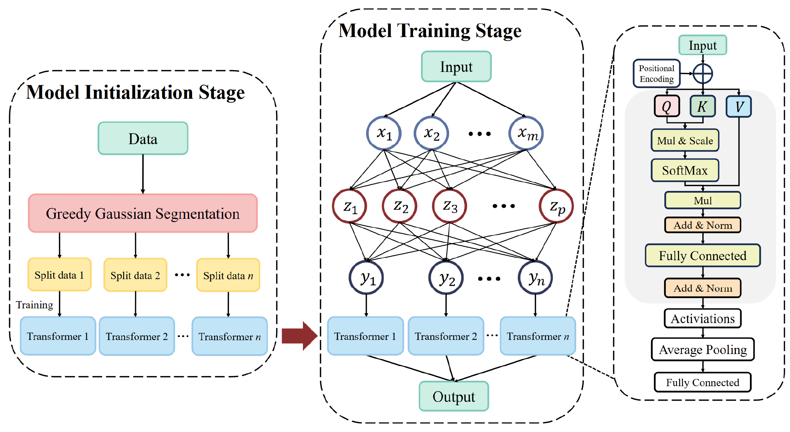
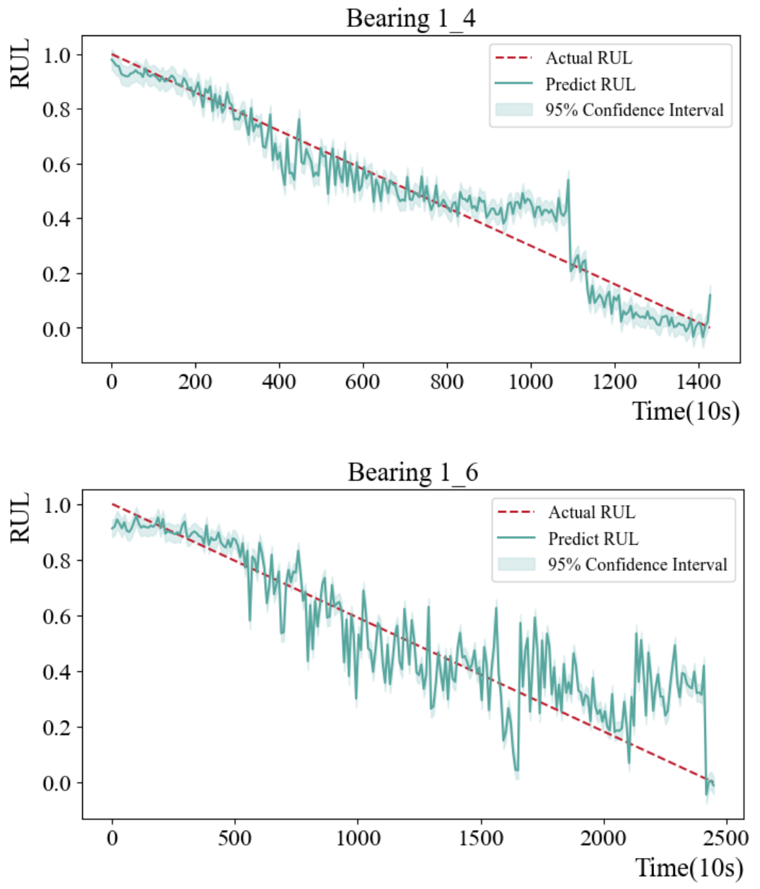
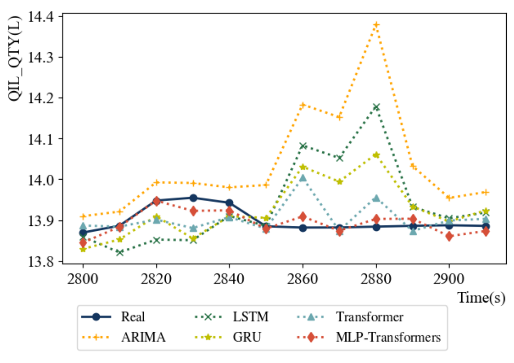

<div align="center">

# MLP–Transformers


A multi-layer perceptron coordinates specialized Transformer models for time series with changing patterns. The study evaluates bearing remaining useful life and jet-engine lubrication oil forecasting.


[Research page](https://Kisen7.github.io/MLP-Transformer/) · [Paper](https://doi.org/10.1109/SGES63808.2024.10824143) · [中文](README.zh-CN.md)


</div>


## Research framework





The original architecture illustrates model initialization, coordinated training, and the prediction stage.

- **Model initialization** — Initialize a set of Transformer models using time-series subsets with different characteristics.

- **Coordinated training** — The MLP learns model selection while Transformer models specialize in corresponding data patterns.

- **Model prediction** — Input batches are classified by the MLP and passed to the corresponding Transformer.


## Research results


### Bearing RUL





The paper reports an average MAE of 0.116 and an average RMSE of 0.150 across seven bearing sequences in Table I.


### Lubrication oil





The original comparison of prediction curves. Table II reports MSE 0.0531 and MAE 0.1757 for MLP-Transformers on this task.


## Publications


**[MLP-Transformers: Multi-Layer Perceptron coordinated Transformers for Time Series Forecasting](https://doi.org/10.1109/SGES63808.2024.10824143)**

Shuhuai Gu, Junyou Zhang, Yutong Peng, Liqi Ye, Jing Wang, Qi Xi. *SGES*, 2024, pp. 161–166.


## Repository materials


| Material | Location |
| --- | --- |
| Experiment notebook | [main.ipynb](https://github.com/Kisen7/MLP-Transformer/blob/main/main.ipynb) |
| Saved models | [models/](https://github.com/Kisen7/MLP-Transformer/tree/main/models) |
| Paper | [SGES 2024 · IEEE](https://doi.org/10.1109/SGES63808.2024.10824143) |
| Repository | [Kisen7/MLP-Transformer](https://github.com/Kisen7/MLP-Transformer) |


## Citation


```bibtex
@inproceedings{MLPTransformer2024,
  title = {MLP-Transformers: Multi-Layer Perceptron coordinated Transformers for Time Series Forecasting},
  author = {Shuhuai Gu and Junyou Zhang and Yutong Peng and Liqi Ye and Jing Wang and Qi Xi},
  year = {2024},
  booktitle = {SGES},
  doi = {10.1109/SGES63808.2024.10824143}
}
```
