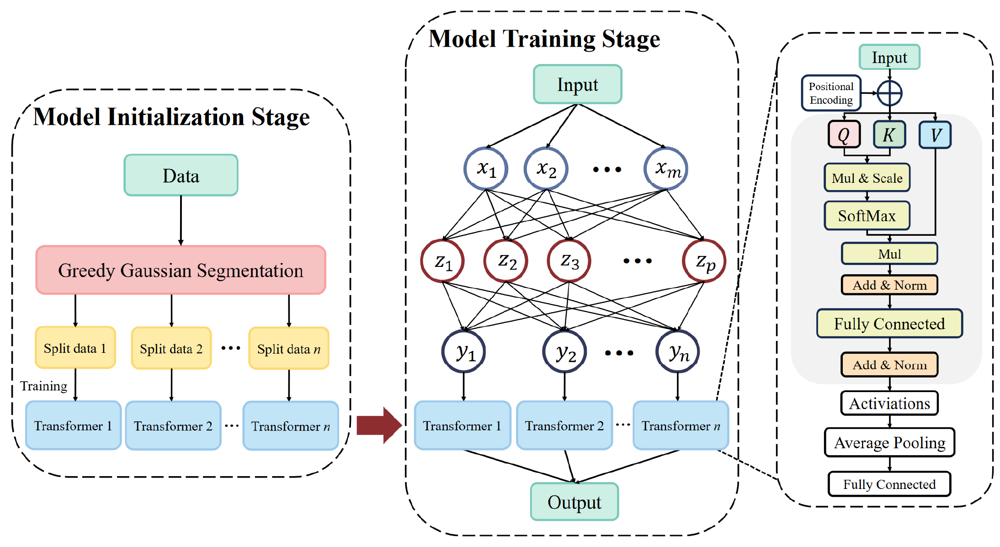
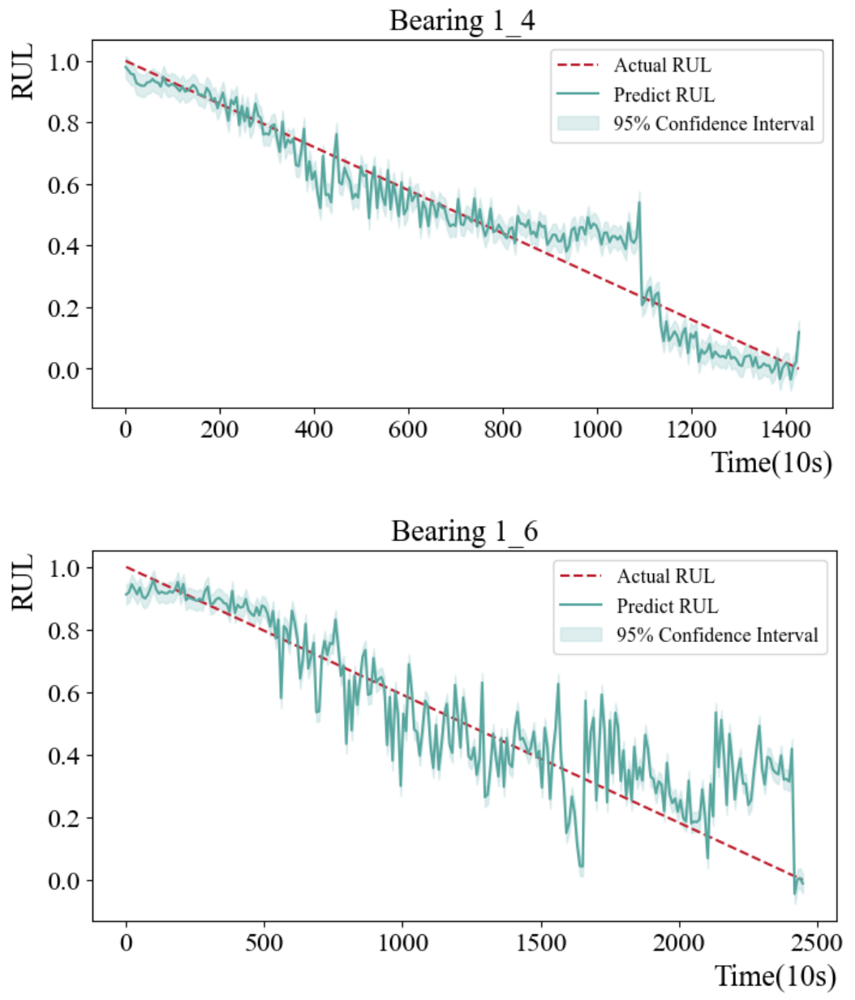
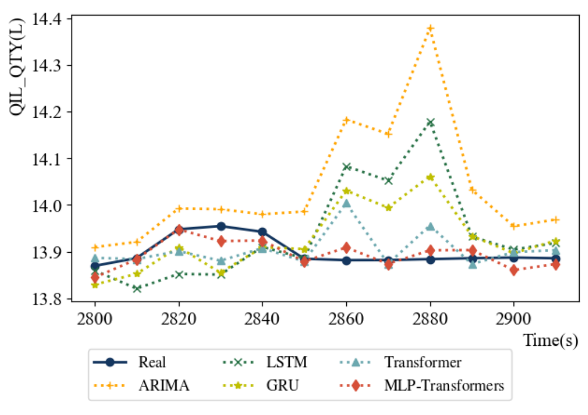

<div align="center">

# MLP–Transformers


通过多层感知机协调不同 Transformer 模型，处理模式变化的时间序列；论文研究了轴承剩余寿命与航空发动机润滑油量预测。


[研究主页](https://Kisen7.github.io/MLP-Transformer/) · [论文](https://doi.org/10.1109/SGES63808.2024.10824143) · [English](README.md)


</div>


## 研究框架





原始架构图展示模型初始化、协同训练与预测阶段。

- **模型初始化** — 利用具有不同特征的时序子集初始化 Transformer 模型。

- **协同训练** — MLP 学习模型选择，Transformer 则针对相应数据模式训练。

- **模型预测** — 输入数据批次经 MLP 分类后，由对应 Transformer 完成预测。


## 研究结果


### 轴承剩余寿命





论文表 I 报告了七条轴承序列的平均 MAE 0.116、平均 RMSE 0.150。


### 润滑油量





不同方法预测曲线的原始对比；表 II 中 MLP-Transformers 在该任务上的 MSE 为 0.0531、MAE 为 0.1757。


## 论文


**[MLP-Transformers: Multi-Layer Perceptron coordinated Transformers for Time Series Forecasting](https://doi.org/10.1109/SGES63808.2024.10824143)**

Shuhuai Gu, Junyou Zhang, Yutong Peng, Liqi Ye, Jing Wang, Qi Xi. *SGES*, 2024, pp. 161–166.


## 项目材料


| 材料 | 入口 |
| --- | --- |
| 实验笔记本 | [main.ipynb](https://github.com/Kisen7/MLP-Transformer/blob/main/main.ipynb) |
| 已保存模型 | [models/](https://github.com/Kisen7/MLP-Transformer/tree/main/models) |
| 论文 | [SGES 2024 · IEEE](https://doi.org/10.1109/SGES63808.2024.10824143) |
| 项目仓库 | [Kisen7/MLP-Transformer](https://github.com/Kisen7/MLP-Transformer) |


## 引用


```bibtex
@inproceedings{MLPTransformer2024,
  title = {MLP-Transformers: Multi-Layer Perceptron coordinated Transformers for Time Series Forecasting},
  author = {Shuhuai Gu and Junyou Zhang and Yutong Peng and Liqi Ye and Jing Wang and Qi Xi},
  year = {2024},
  booktitle = {SGES},
  doi = {10.1109/SGES63808.2024.10824143}
}
```
